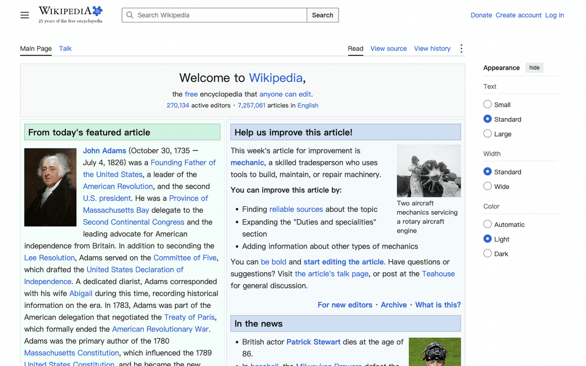

# dsh-computer-use · DeepSeek Harness 计算机操作插件

[English](README.en.md) · [MIT](LICENSE)

为 DeepSeek Harness 提供浏览器操作和 macOS 桌面操作的 Cordis 插件。Agent 使用同一个 `computer_use` 工具观察、点击、输入并验证结果；URL 打开隔离浏览器，应用名选择桌面应用。

## 演示

以下 GIF 由插件自身的 BrowserDriver 脚本操作隔离浏览器、访问公开站点录制，未调用模型：

| 场景 | 演示 |
|---|---|
| Figma 官网浏览 |  |
| Wikipedia：搜索并打开 Playwright 软件词条 |  |
| GitHub 仓库浏览 |  |

Wikipedia 动图展示首页、搜索框聚焦、输入 `Playwright (software)` 和最终词条四个已验证状态，分别停留 1、0.5、2、4 秒；展示时长不表示实际响应延迟。录制入口为 `node scripts/record-demo.mjs wikipedia`；录制前须在插件目录安装依赖，输出保存在 `.playwright-mcp/`。

桌面演示可在本机运行 `node test/driver.desktop.e2e.mjs`：通过辅助功能操作计算器完成 `7 + 3 = 10`，检查焦点、鼠标位置和目标窗口截图。桌面录制文件默认不纳入 Git。

## 安装

需要 DeepSeek Harness 0.2.1-rc.3 或更新版本、Node.js、Google Chrome。桌面驱动需要 macOS 14 或更新版本以及 Xcode Command Line Tools。

1. 在插件目录运行 `npm install`。
2. 需要桌面操作时运行 `bash native/build.sh`，在系统设置中为 Harness/helper 授予辅助功能与屏幕录制权限。
3. 在 Harness 插件管理器中安装本目录。外部 link 包的依赖需在插件目录单独安装。

```yaml
- id: computer-use
  name: '@local/dsh-computer-use'
  config:
    mode: auto
    browser:
      channel: chrome
      headless: false
      viewport: { width: 1280, height: 800 }
    desktop:
      inputMode: background
    screenshotDir: computer-use/screenshots
```

## 使用与范围

- `open`：URL 选择浏览器；应用名（如 `Calculator`）选择桌面应用。`mode: browser` 或 `desktop` 可固定驱动。
- `screenshot`：浏览器只截视口；桌面只截选定应用的主窗口，找不到窗口或无权限时直接报错，不回退到整屏。应用有多个窗口时选择面积最大的普通窗口。
- `get_state`：读取页面元素或目标应用的 AX 元素，以及系统窗口信息。桌面截图后的坐标相对于该窗口，驱动换算为系统坐标。
- `click` / `type` / `keypress` / `scroll`：浏览器支持这些操作。桌面默认 `background` 优先点击命中的 AX 控件；没有控件时使用最近一次窗口截图的窗口标识和坐标投递左键单击或双击。返回 `dispatched: true, verified: false` 只表示已发送，必须再次截图核对结果。
- 桌面后台模式支持向目标窗口输入文字和按键组合，滚动仍不支持。文本优先使用 AX 文本框；没有 AX 文本框时采用按进程和窗口投递的键盘事件，要求先点击输入框，并确认该窗口是目标应用的焦点窗口。后台坐标点击要求窗口未隐藏、未最小化且几何信息与截图一致；窗口改变或系统私有接口不可用时直接报错，不自动切换前台。`inputMode: global` 使用前台真实鼠标与键盘，会影响用户输入。
- `wait` 等待，`close` 关闭浏览器与 helper，并等待 helper 退出。

后台模式选择运行中的应用不会激活窗口；启动新应用使用系统后台启动选项，应用自身仍可能请求激活。它通过 macOS 辅助功能和按进程投递事件工作，没有向目标进程注入代码，也不提供独立桌面或任意软件的虚拟鼠标。

截图进入 Harness 附件管线；模型路由声明图片输入时发送图片，否则返回本地文件路径。截图可能包含目标应用中的私人内容，附件和截图目录同样需要按私人数据处理。

## 验证

```sh
node --test test/privacy.test.mjs test/background-click.test.mjs
node test/background-pointer.e2e.mjs
node test/driver.desktop.e2e.mjs
```

`background-pointer.e2e.mjs` 仅操作自建后台窗口，验证原生坐标点击使独立计数从 0 变为 1，失效截图和越界点击不改变计数，并核对前台应用与鼠标位置；窗口和截图在退出时清理。

第一条检查截图范围、后台应用选择、窗口标识与坐标转换、失败不重放以及 helper 退出与重启；计算器场景操作本机计算器，需要系统权限，且检查期间用户移动鼠标会使鼠标静止断言失败。浏览器测试 `test/driver.e2e.mjs` 使用本地测试页，需先提供 `http://127.0.0.1:8734/test-page.html`。

## 数据清理

桌面截图和录制不自动上传。删除当前文件和重写历史不能保证旧缓存已移除；需按 [GitHub 敏感数据清理说明](https://docs.github.com/en/authentication/keeping-your-account-and-data-secure/removing-sensitive-data-from-a-repository) 联系 GitHub Support。重新公开仓库不代表旧对象和缓存已经彻底清除。

## License

MIT © Chengyunlai。见 [LICENSE](LICENSE)。

后台窗口点击序列改编自 [Cua Driver cua-driver-rs-v0.38.0](https://github.com/trycua/cua/tree/cua-driver-rs-v0.38.0/libs/cua-driver/rust/crates/platform-macos/src/input) 的 `mouse.rs` 和 `skylight.rs`，遵循 [MIT 许可](native/LICENSE.cua-driver)。该路径依赖 macOS 私有接口，不保证跨系统版本或跨应用可用。
